<div align="center">


# Mawid · موعد

**Multi-tenant clinic management and online appointment booking, in English and Arabic.**

Patients find a clinic and book a time that is genuinely free. Clinic teams run their whole day from one shared schedule.


[Overview](#overview) · [Screenshots](#screenshots) · [Features](#features) · [Architecture](#architecture) · [Security](#database-and-security) · [Getting started](#getting-started) · [Testing](#testing) · [Status](#project-status)

</div>

---

## Overview

**Mawid** (Arabic for *appointment*) is a full-stack platform for outpatient clinics. Each clinic is an isolated tenant with its own doctors, services, specialties, working hours, patients and appointments.

**The problem.** Many clinics in Egypt still take bookings by phone or messaging apps and keep the day in a paper ledger. Patients can't see which times are really free. Front-desk staff juggle overlapping requests. Owners have no reliable view of how the clinic is doing.

**What Mawid does.**

- **Live availability.** Mawid computes open times from each doctor's hours, the clinic's hours, closures and existing bookings. Patients only see times that can actually be booked.
- **One schedule for staff.** Owners, receptionists and doctors share it, each with permissions that fit their role.
- **Bilingual.** The interface is fully Arabic (right-to-left) and English, with times shown in the clinic's own timezone (default `Africa/Cairo`).

**Who it is for:**

| User | Typical use |
|---|---|
| Patients | Find a clinic, book online, reschedule or cancel, receive notifications |
| Clinic owners | Set up the clinic, manage the team, follow the schedule and analytics |
| Receptionists | Run the front desk: walk-ins, confirmations, moving appointments, patient records |
| Doctors | See and manage their own appointments, hours and leave |
| Platform admin | Oversee clinics and users, suspend or reactivate a clinic, review the platform audit log |

The visual design, called «دفتر المواعيد» (*the appointment ledger*), takes its cue from the paper booking books used at Egyptian clinic front desks.

## Screenshots

All screenshots come from the running application (production build, served by Express) using **fictional demo data** on a local test database.

<table>
  <tr>
    <td width="50%">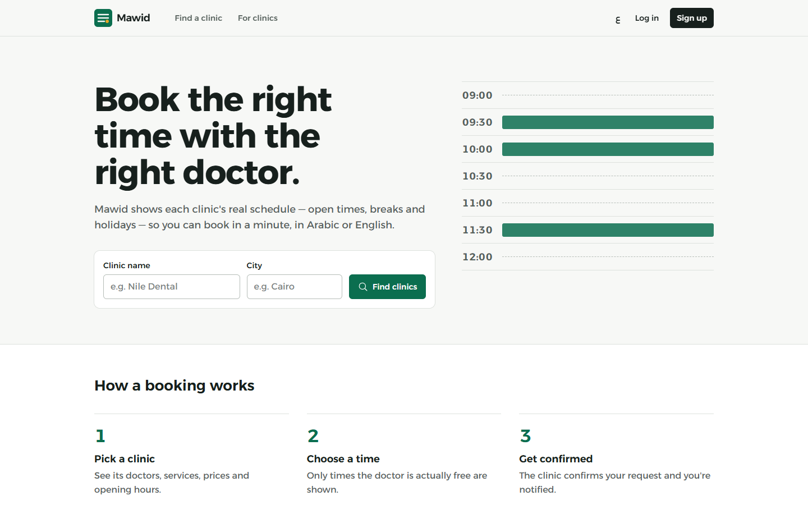<br><sub><b>Landing page</b>: search by clinic name and city</sub></td>
    <td width="50%">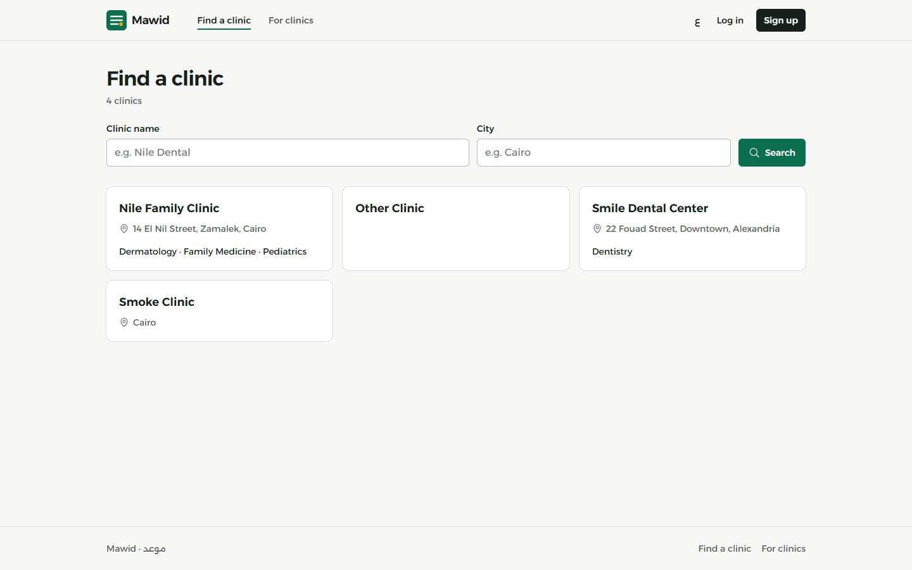<br><sub><b>Clinic discovery</b></sub></td>
  </tr>
  <tr>
    <td>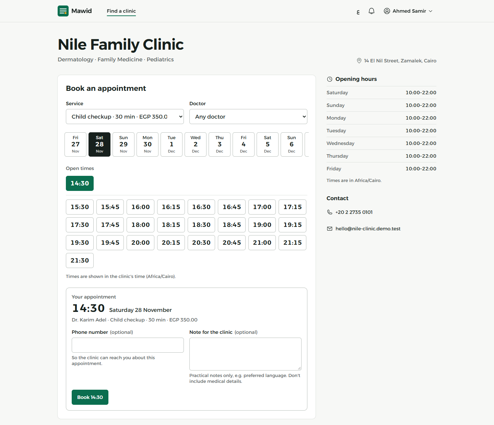<br><sub><b>Clinic page and booking</b>: only bookable times are offered</sub></td>
    <td>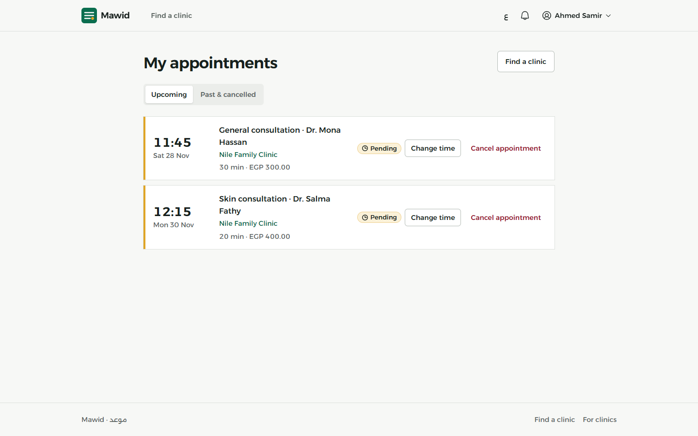<br><sub><b>Patient portal</b>: change time or cancel</sub></td>
  </tr>
  <tr>
    <td>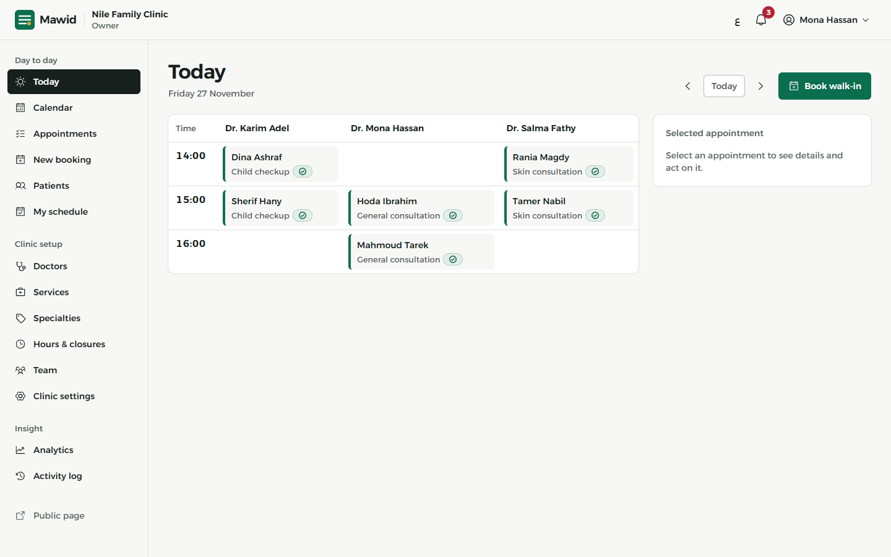<br><sub><b>Today</b>: time × doctor schedule for the front desk</sub></td>
    <td>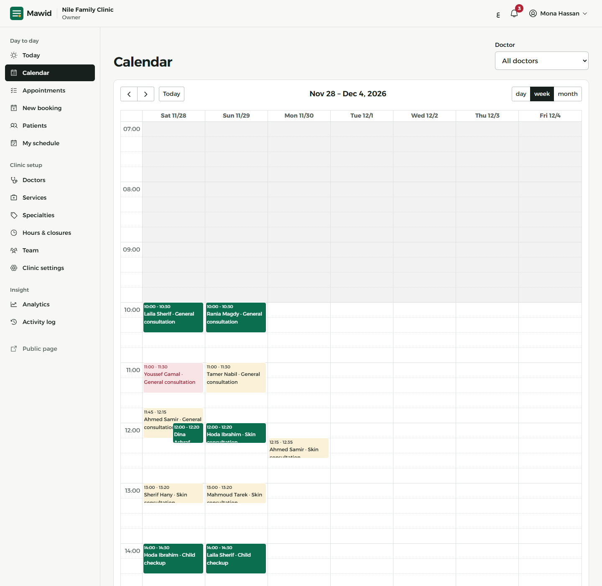<br><sub><b>Calendar</b>: week view in clinic time, colour-coded by status</sub></td>
  </tr>
  <tr>
    <td>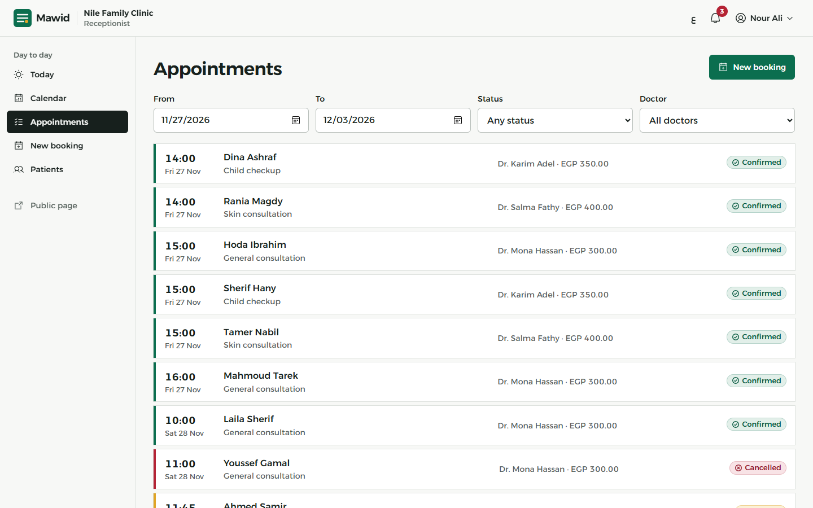<br><sub><b>Appointments</b>: filter by date, status and doctor (receptionist view)</sub></td>
    <td>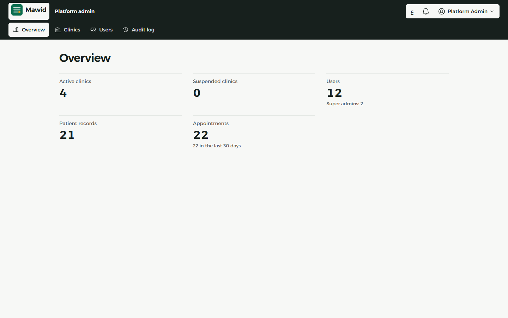<br><sub><b>Platform admin</b>: overview</sub></td>
  </tr>
  <tr>
    <td>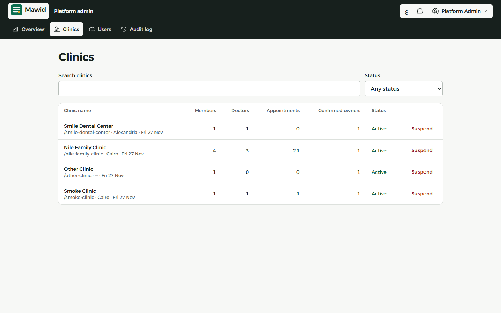<br><sub><b>Platform admin</b>: clinics with suspend / reactivate</sub></td>
    <td>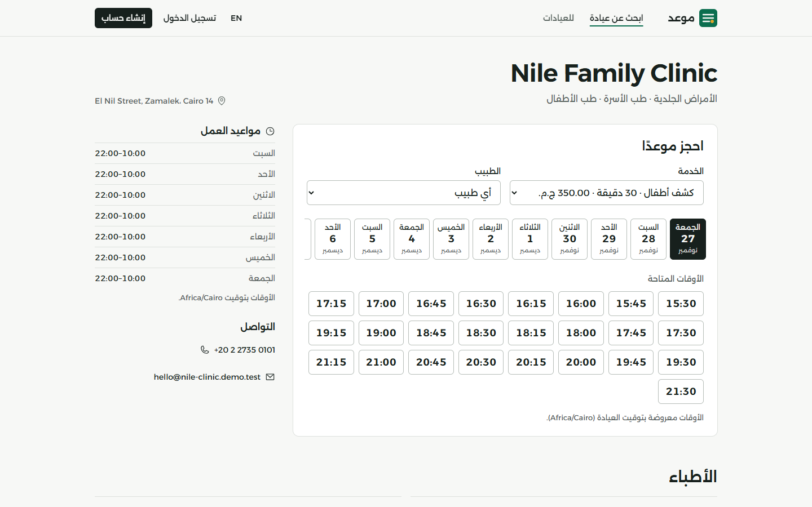<br><sub><b>Arabic, right-to-left</b>: public clinic page</sub></td>
  </tr>
  <tr>
    <td>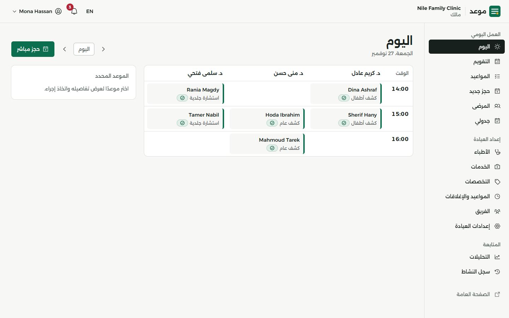<br><sub><b>Arabic, right-to-left</b>: staff workspace</sub></td>
    <td>
      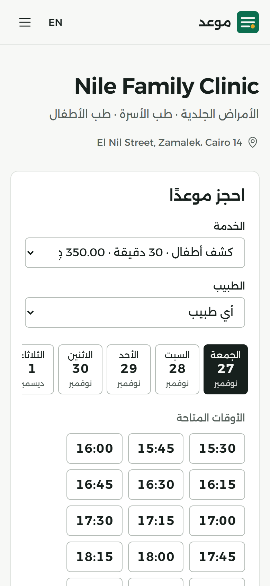
      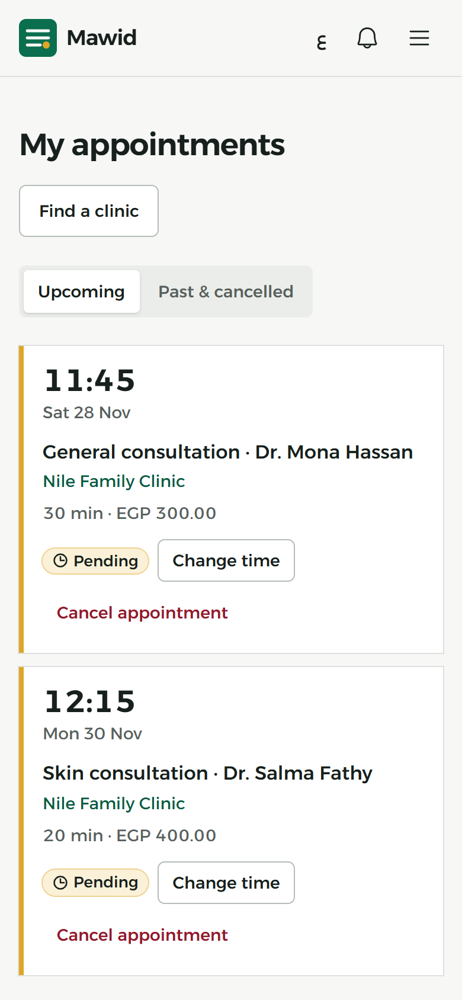
      <br><sub><b>Mobile</b> (390 px): Arabic clinic page and patient appointments</sub>
    </td>
  </tr>
</table>

## Features

### Patients
- Discover clinics by name and city; each clinic page shows services, prices, doctors, opening hours and contact details.
- Book online from live availability, optionally choosing a doctor. A visitor can sign up mid-booking and keep their selection.
- *My appointments*: upcoming and past bookings, change the time, or cancel with a reason (allowed until 2 hours before the start).
- In-app notifications and a profile with a language preference.

### Clinic management (owner)
- Create a clinic with a public URL, timezone, contact details and default language.
- Bilingual specialties and services, with duration and exact decimal pricing (stored as integers, never as floating point).
- Doctor profiles linked to services and specialties.
- Weekly working hours with breaks, for the clinic and for each doctor, plus holidays, leave and unavailable periods.
- Team management by invitation (owner, doctor or receptionist roles).
- Clinic analytics: status totals, no-show and cancellation rates, completed revenue, a daily series, per-doctor figures and top services.
- An activity log of every administrative change.

### Doctor and receptionist workflows
- **Receptionist:** the Today view, calendar, appointment list, new booking and walk-ins, patient records; can confirm, cancel or move appointments.
- **Doctor:** sees only their own appointments; can confirm them, complete them or mark a no-show, and edits their own hours and leave.

### Appointment management
- Lifecycle: `PENDING → CONFIRMED → COMPLETED / NO_SHOW`, or `CANCELLED`, with rescheduling.
- Each booking keeps a snapshot of the price and duration at booking time.
- Booking rules:
  - 15-minute slot grid;
  - 60-minute minimum notice for online bookings;
  - 90-day booking horizon;
  - a limit of 5 upcoming online bookings per patient.
- **No double booking, even under concurrency.** Bookings run in a transaction with ordered row locks. Every rule is checked again inside the lock, and deadlocks are retried. Concurrency tests race 10 patients for one slot.

### Platform administration (Super Admin)
- Platform overview, a clinics list with suspend / reactivate, user platform roles and a platform audit log.
- No implicit access to clinic data. A suspended clinic disappears from public pages.
- The first Super Admin is granted from the command line (`scripts/make-super-admin.js`), never through the API.

### Authentication and account security
- Session authentication:
  - HttpOnly cookie;
  - session ID regenerated at login;
  - CSRF synchronizer token;
  - constant-time login checks;
  - rate limits.
- **Email verification.** Sign-up always answers with the same generic response, so it doesn't reveal which emails are registered.
- **Password reset.** Single-use, expiring tokens are sent only in the URL fragment (`#token=`), so they never reach server logs. A reset signs out every other session (`session_version`).
- **Invitations.** Staff join a clinic only by accepting an invitation sent to their verified email address. Clinic membership can't be granted just by typing an email address.
- **Account protection.** Per-email rate limits and resend cooldowns are stored in the database.

### Multi-tenant isolation
- The clinic is resolved from the URL slug **and** the caller's active membership. A `clinicId` sent by the client is never trusted.
- Every tenant query is scoped to the clinic.
- Rows that belong to a clinic reference each other through **composite foreign keys `(clinic_id, id)`**, so the database itself rejects links across clinics.
- Requests for another clinic's resources answer `404`.

### Notifications and email
- In-app notifications are written inside the same transaction as the booking change. A separate script (`scripts/send-reminders.js`) sends 24-hour reminders and never sends the same reminder twice.
- Account emails (verification, password reset, invitations) go through a delivery queue. The queue recovers from crashes and retries failures.
- Email providers:
  - **Development:** `outbox` writes emails as files under `var/mail-outbox/` instead of sending them.
  - **Production:** SMTP via Nodemailer, TLS ≥ 1.2. It is implemented but not yet tested against a real provider.

## Technology stack

| Layer | Technologies |
|---|---|
| **Backend** | Node.js 24, Express 5 (CommonJS), Prisma ORM 7 with the MariaDB driver adapter, Zod 4, express-session with a Prisma-backed session store, Helmet, express-rate-limit, Pino, bcrypt, Luxon, Nodemailer |
| **Database** | MariaDB 10.4, 6 ordered Prisma migrations, CHECK constraints, composite foreign keys |
| **Frontend** | React 19, TypeScript 5.9, Vite 7, Tailwind CSS 4, React Router 7, TanStack Query 5, React Hook Form + Zod, FullCalendar 6 (Luxon timezone plugin), Recharts 3, Phosphor Icons, self-hosted Alexandria variable font |
| **Testing** | Node.js built-in test runner: unit tests, and integration tests against a real, disposable MariaDB database |
| **Operations** | nginx and systemd example configs, backup and restore-drill scripts, health and readiness endpoints |

## Architecture

Mawid is a **modular monolith**: one Express application serves a versioned REST API (`/api/v1`) and, in production, the built React single-page app. Every request follows the same path:
- **Route** → Zod validation.
- **Controller** → HTTP only.
- **Service** → business rules and transactions.
- **Prisma** → the database.

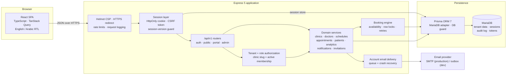

Key design decisions:

- **Time.** Instants are stored in UTC. Weekly hours are stored as wall-clock minutes in the clinic's IANA timezone, so daylight-saving changes don't shift opening hours.
- **Availability** = doctor hours ∩ clinic hours − closures − existing bookings, computed in the clinic's timezone.
- **Database guard.** The app and the Prisma CLI refuse any database not named `mawid` / `mawid_*`, and refuse a mismatch between the configured database name and the connection URL.
- **Production mode** (`SERVE_WEB=1`):
  - Express also serves the built SPA, with an explicit Content Security Policy.
  - It adds HTTPS enforcement and HSTS.
  - The session cookie is a `__Host-` cookie.
- **Health checks.** `/healthz` (process) and `/readyz` (database, 2 s timeout) for uptime monitoring.

More detail lives in [`docs/architecture/`](docs/architecture), for example:
- [`03-appointments.md`](docs/architecture/03-appointments.md): the booking engine.
- [`07-account-security.md`](docs/architecture/07-account-security.md): account security.

## Project structure

```text
Mawid-Nodejs/
├── src/                      Express API (Node.js, CommonJS)
│   ├── config/               database client, database guard, privilege checks, startup checks
│   ├── middleware/           auth, tenant context, CSRF, validation, rate limits, errors
│   ├── modules/              one folder per domain: routes · controller · service · schemas
│   │   ├── auth/             sign-up, login, verification, password reset, email delivery
│   │   ├── appointments/     availability, booking engine, lifecycle, patient portal
│   │   ├── clinics/ doctors/ schedules/ clinic-services/ specialties/ patients/
│   │   ├── invitations/ membership/ notifications/ analytics/ admin/
│   ├── lib/                  logger, errors, permissions, time zones, audit log
│   └── views/                legacy server-rendered pages (original events feature)
├── prisma/                   schema and ordered migrations
├── web/                      React + TypeScript single-page app (Vite)
│   └── src/
│       ├── pages/            public · auth · portal · staff · admin · workspace
│       ├── components/       UI kit, layout shell, staff and public components
│       ├── api/              typed fetch client and endpoints (CSRF-aware)
│       ├── auth/             auth provider, route guards, role permissions
│       └── i18n/             English and Arabic dictionaries, RTL handling
├── tests/                    unit tests and integration tests (real database)
├── scripts/                  dev servers, test database setup, admin bootstrap, ops checks
├── deploy/                   nginx, systemd, database-account SQL, backup and restore drill
└── docs/                     architecture notes, design direction, operations guide
```

## Database and security

| Area | Implementation | Status |
|---|---|---|
| Multi-tenant design | Clinic-scoped tables; composite `(clinic_id, id)` foreign keys; tenant resolved from slug + membership | Implemented and tested |
| Role-based access control | Owner, receptionist and doctor roles per clinic; platform Super Admin; enforced by the API on every request (the UI only mirrors it) | Implemented and tested |
| Sessions | Database-backed sessions, HttpOnly cookie (`__Host-` in production), CSRF synchronizer token, session version for revocation | Implemented and tested |
| Email verification | Required before an account can join or own clinic data; generic sign-up response | Implemented and tested |
| Password recovery | Single-use expiring tokens in the URL fragment; reset revokes other sessions | Implemented and tested |
| Invitations | Accepted only by the verified invitee; per-recipient quotas and cooldowns | Implemented and tested |
| Database privilege separation | `mawid_app` (data only) and `mawid_migrator` (schema changes, no DROP) accounts; production refuses root, weak passwords and over- or under-privileged grants | Implemented; **account creation on a server is pending** |
| Audit | Clinic and platform audit logs for administrative changes | Implemented |
| Backups | Logical backup and restore-drill scripts with checksum and safety checks | Implemented; a first backup and restore drill passed locally |

## Getting started

### Prerequisites

- **Node.js 24** and npm
- **MariaDB 10.4+**; a local XAMPP installation works
- Git

> **Use a dedicated, empty database for local work.** The commands below only target a database named `mawid_test`. Mawid's database guard refuses anything not named `mawid` / `mawid_*`. No command here resets or drops data.

### 1. Clone and install

```powershell
git clone https://github.com/Youssef-ibrahim200038542/Mawid-Nodejs.git
cd Mawid-Nodejs
npm install
npm --prefix web install
```

### 2. Configure the environment

```powershell
Copy-Item .env.test.example .env.test
```

Edit `.env.test`:

1. Set your local MariaDB user and password.
2. Keep `DB_NAME=mawid_test`, and make sure `DATABASE_URL` points at the same database.
3. Set a `SESSION_SECRET`. You can generate one with:

```powershell
node -e "console.log(require('node:crypto').randomBytes(32).toString('base64url'))"
```

`.env*` files are git-ignored. Only the `*.example` templates are committed.

### 3. Create the database and apply migrations

Create the empty database once (or use phpMyAdmin; with XAMPP, `mysql.exe` is in `C:\xampp\mysql\bin`):

```powershell
mysql -u root -p -e "CREATE DATABASE mawid_test CHARACTER SET utf8mb4 COLLATE utf8mb4_unicode_ci;"
```

Then apply the migrations:

```powershell
npm run test:db:migrate
```

`test:db:migrate` works only with `mawid_test`. It runs `prisma migrate deploy` and never a reset.

### 4. Run the app

Run the API and the web app in two terminals.

API on http://localhost:3100:

```powershell
npm run dev:test-db
```

Web app on http://localhost:5173:

```powershell
npm run web:dev
```

Open http://localhost:5173 and sign up. In development, emails are not sent. Verification and invitation links are written to `var/mail-outbox/*.json`.

To make your account a platform Super Admin:

```powershell
node --require ./tests/integration/env.js scripts/make-super-admin.js you@example.com
```

### Production build

```powershell
npm run build:prod
npm run start:prod
```

Production configuration starts from [`.env.production.example`](.env.production.example). The app refuses to start without:
- a real email provider;
- HTTPS URLs;
- a least-privilege database account.

See the [deployment guide](docs/operations/deployment.md).

## Testing

| Suite | Command | Latest verified result |
|---|---|---|
| Unit tests | `npm test` | **108 / 108 passing**: configuration, permissions, privilege checks, booking rules, backup-script safety |
| Integration tests | `npm run test:integration` | **91 / 91 passing**: run against a dedicated, disposable `mawid_test_it` database |
| Typecheck + production build | `npm run web:build` | **Passing** |
| Browser smoke test | manual, on the production build | **Passed** |

**Running integration tests for the first time.** Set up the disposable database once:

```powershell
npm run test:integration:setup -- --create
```

This creates `mawid_test_it` and its env file. Each run then empties and reseeds it, and the suite refuses to run against any other database.

**What the integration tests cover:**
- authentication and session lifecycle, and CSRF;
- isolation between clinics, and role permissions;
- composite foreign key and CHECK enforcement in the database;
- availability and daylight-saving handling;
- concurrent booking races;
- the full appointment lifecycle, the patient portal, notifications and reminders, analytics, the admin API and account security.

**What the browser smoke test went through:**
1. Sign up, then verify the email.
2. Set up the clinic: services, doctors and hours.
3. A patient books.
4. Staff confirm the booking.
5. The patient cancels.
6. Requests across clinics are refused.
7. The admin suspends and reactivates the clinic.
8. Mobile layout at 375 px.

## Project status

Mawid is **feature-complete for its first version** and has had substantial production-hardening work. **It is not deployed and not yet production-ready.** The code side is done; what remains is operational:

| Remaining step | Status |
|---|---|
| Create the least-privilege `mawid_app` / `mawid_migrator` database accounts and pass the privilege verifier | Pending |
| Configure SMTP and verify real email delivery | Pending (needs provider credentials) |
| Hosting, domain, HTTPS (nginx + TLS) and uptime monitoring | Pending |
| Apply the 4 pending migrations to the production database after a verified backup | Pending (rollout plan in [`05-migration-review.md`](docs/architecture/05-migration-review.md)) |

## Roadmap

**Implemented**
- Multi-tenant clinic platform with patient, staff and admin interfaces.
- Concurrency-safe booking engine, schedules, closures, notifications and analytics.
- Account security: verification, password reset, invitations and session revocation.
- Production hardening: CSP, HTTPS, health checks, least-privilege database design, backups.

**Operational setup pending**
- Database accounts, SMTP delivery, hosting with HTTPS and monitoring, production migration rollout.

**Future improvements**
- Automated end-to-end browser test suite.
- Shared rate-limit store so the app can run more than one process.
- Scheduled reminder job, and SMS / WhatsApp reminders.
- Per-clinic booking rules (slot length, notice, cancellation window).
- An email-change flow for account recovery.

## Author

**Youssef Ibrahim**, GitHub: [@Youssef-ibrahim200038542](https://github.com/Youssef-ibrahim200038542)
